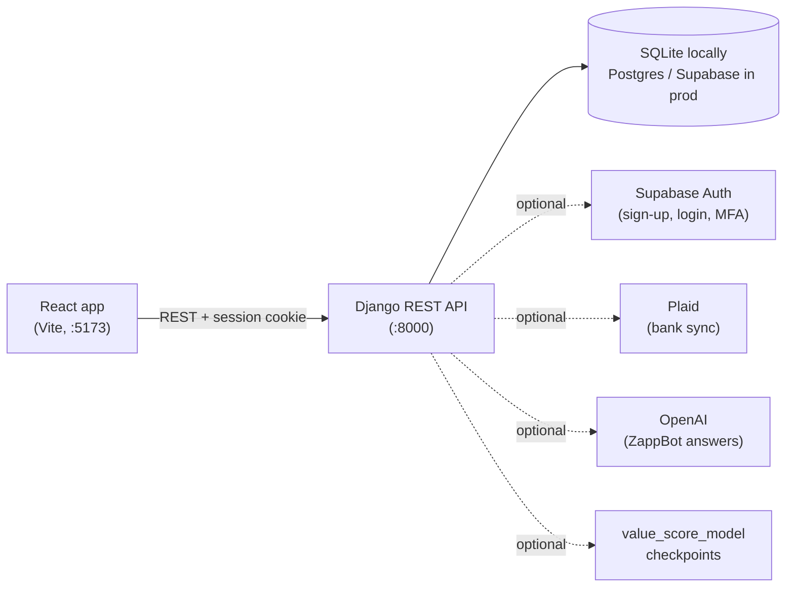

# Zapp: Your Personal CFO

People don't necessarily waste money; they misjudge **value**. Zapp helps you decide
whether a purchase is worth it *before* the charge hits, then learns from what you
actually buy and how you feel about it afterwards.

**▶ [Watch the demo video](https://drive.google.com/file/d/1qQUz1jCqbmXztDwHBCopLaOQPJzMhOva/view?usp=sharing)**


This monorepo contains the two core services:

- **`frontend/`**: React + TypeScript single-page app (Vite, Tailwind, Radix UI, Recharts)
- **`backend/`**: Django 6 + Django REST Framework API

---

## Contents

- [What Zapp does](#what-zapp-does)
- [How it works](#how-it-works)
- [Quick start (local demo)](#quick-start-local-demo)
- [Manual setup](#manual-setup)
- [Configuration](#configuration)
- [Everyday commands](#everyday-commands)
- [Project structure](#project-structure)
- [API overview](#api-overview)
- [CI/CD](#cicd)
- [Troubleshooting](#troubleshooting)

---

## What Zapp does

Everything is scored on one **0–150 value scale**: about **100 means a purchase is a
good match** for you, below 90 is below target, and above 100 is high value.

### Dashboard

Month-to-date spending compared with the same point last month, your average value
score, a 14-day daily spend chart, and how many purchases landed above or below target.
Streaks, points, badges, weekly/monthly reviews and monthly targets sit on top.


### Buy Advisor: "should I buy this?"

Enter an item, a price and a category. Zapp checks it against **your own last 180 days**
in that category:

- how you rated similar purchases
- whether it pushes you past your usual monthly spend
- how the price compares with what you typically pay
- how often you've bought in that category lately

It returns a score, a verdict (**Looks worth it**, **Sleep on it** or **Probably skip**),
and a plain-language reason for every factor. It's a transparent rule-based check,
not an AI prediction.


### Decision Engine

Start a purchase check from a search box, and see which spending categories have
given you the most and least value.


### Transactions and subscriptions

A single timeline of manual and bank-synced transactions (bank sync via Plaid), with a
spending calendar. Recurring subscriptions each get their own value score and
recommendation.

| Transactions | Subscriptions |
| --- | --- |
|  |  |

### ZappBot

An assistant that answers questions about your own spending. Without an OpenAI key
it still answers spending and subscription summaries from your data. With
`OPENAI_API_KEY` set, it handles open-ended questions and streams its replies.


### Sign-in and the public waitlist

Real accounts use Supabase (email/password or Google) with MFA. For local demos there's
a **Try the demo account** button. The public waitlist page (`/waitlist`) collects
early-access signups and works on mobile.

| Sign in | Waitlist (mobile) |
| --- | --- |
|  |  |

---

## How it works



- **Auth:** the backend holds Supabase tokens server-side and gives the browser a Django
  session cookie (CSRF-protected). Logging in requires MFA, so the session must reach
  Supabase's AAL2 assurance level. Locally, the demo login issues an equivalent fully
  verified session for a seeded user.
- **Value scores**, best source first:
  1. a model score (`personal_value_score`, 0–150) from the external
     [`value_score_model`](https://github.com/zapp-startup/value_score_model) checkpoints
  2. a feedback score derived from your ratings (satisfaction, regret, repurchase intent)
  3. a rating-based estimate
- **Sensitive fields** such as amounts, descriptions and profile answers are encrypted at
  rest with app-level Fernet keys.
- **Demo data** comes from an agent-based synthetic data generator in `backend/datagen/`,
  which produces about 6 months of realistic transactions, subscriptions, ratings and
  conversations.

---

## Quick start (local demo)

**Requirements:** macOS or Linux shell, **Python 3.13**, **Node 20+** (CI uses Node 20).
No external accounts or API keys are needed.

```bash
git clone https://github.com/adhvikrayaprolu/Zapp.git
cd Zapp
./scripts/setup-local.sh   # one time: venv, dependencies, local .env files, SQLite DB, demo account
./scripts/dev.sh           # starts the API on :8000 and the app on :5173 (Ctrl+C stops both)
```

Open **http://127.0.0.1:5173/login** and click **Try the demo account**. You'll land on
the dashboard as `demo_user_0` with about 6 months of synthetic data.

`setup-local.sh` is safe to re-run: it never overwrites an existing `.env`, and it resets
the demo account to the same data each time. If `python3.13` isn't on your `PATH`,
point to it:

```bash
PYTHON=/path/to/python3.13 ./scripts/setup-local.sh
```

**What works without credentials:** dashboard, transactions, subscriptions, Buy Advisor,
Decision Engine, ZappBot spending summaries, reviews, targets, badges, circles, onboarding
and the waitlist.

**What needs credentials:**

| Feature | Needs |
| --- | --- |
| Real sign-up and login | Supabase |
| Bank linking | Plaid |
| Spotify integration | Spotify app credentials |
| Open-ended ZappBot answers | OpenAI API key |
| Live model recomputation | `value_score_model` checkpoints |

See [Configuration](#configuration).

---

## Manual setup

Use this if you'd rather not use the scripts, or you're on Windows (use the `.venv\Scripts\`
paths there).

### Backend

```bash
cd backend
python3.13 -m venv .venv
source .venv/bin/activate
pip install -r requirements.txt
cp .env.example .env
```

Edit `.env`. The minimum for local work:

```bash
SECRET_KEY=<any long random string>
DATABASE_URL=sqlite:////absolute/path/to/Zapp/backend/db.sqlite3   # use an absolute path
```

Then migrate, seed the demo account and run the server:

```bash
python manage.py migrate
python manage.py seed_demo
python manage.py runserver 127.0.0.1:8000
```

`manage.py` uses `config.settings.development` by default.

### Frontend

```bash
cd frontend
npm ci
cp .env.example .env.local
```

In `.env.local`, set:

```bash
VITE_API_URL=http://127.0.0.1:8000
VITE_DEMO_LOGIN=true
```

Then start the dev server:

```bash
npm run dev    # http://127.0.0.1:5173
```

> Use `127.0.0.1` (not `localhost`) for both apps. Session cookies and CORS are
> configured for the same loopback host.

---

## Configuration

Full annotated lists live in [`backend/.env.example`](backend/.env.example) and
[`frontend/.env.example`](frontend/.env.example). Fill in only what you need.

| You want… | Backend `.env` | Frontend `.env.local` |
| --- | --- | --- |
| The local demo | `SECRET_KEY`, `DATABASE_URL` (the setup script also generates `APP_DATA_ENCRYPTION_KEY` and `PLAID_TOKEN_ENCRYPTION_KEY`) | `VITE_API_URL`, `VITE_DEMO_LOGIN=true` |
| Real sign-up and login | `SUPABASE_URL`, `SUPABASE_JWT_ISS`, `SUPABASE_JWT_AUD`, `SUPABASE_ANON_KEY`, `SUPABASE_JWT_SECRET`, OAuth redirect URIs | `VITE_SUPABASE_URL`, `VITE_SUPABASE_ANON_KEY` |
| ZappBot LLM answers | `OPENAI_API_KEY`, `OPENAI_MODEL` | |
| Bank linking (Plaid sandbox) | `PLAID_CLIENT_ID`, `PLAID_SECRET`, `PLAID_ENV=sandbox` | |
| Spotify | `SPOTIFY_CLIENT_ID`, `SPOTIFY_CLIENT_SECRET` | |
| Live value-score model | `VALUE_SCORE_BUNDLE_PATH`, `VALUE_SCORE_CHECKPOINT_DIR` | |
| A production build | production settings, `ALLOWED_HOSTS`, CORS/CSRF origins | `VITE_API_URL` (https), `VITE_SITE_URL`, `VITE_DEMO_VIDEO_URL` |

Notes:

- Generate Fernet keys with:

  ```bash
  python -c "from cryptography.fernet import Fernet; print(Fernet.generate_key().decode())"
  ```

- `VITE_*` values are compiled into the public JS bundle, so **never put secrets in them**.
- The demo login only works when Django runs with `DEBUG` on and `DEMO_LOGIN_ENABLED`
  (on by default in development). Production settings force it off.
- `.env` files and the SQLite database are gitignored.

---

## Everyday commands

| Task | Command |
| --- | --- |
| Start both servers | `./scripts/dev.sh` |
| Reset the demo account | `cd backend && .venv/bin/python manage.py seed_demo` |
| Generate more synthetic users | `cd backend && .venv/bin/python manage.py seed --users 5 --months 6` |
| Backend tests | `cd backend && .venv/bin/python manage.py test` |
| Backend checks (as CI runs them) | `cd backend && .venv/bin/python manage.py check && .venv/bin/python manage.py makemigrations --check --dry-run` |
| Frontend tests | `cd frontend && npm run test:run` |
| Frontend production build | `cd frontend && npm run build` |
| Regenerate README screenshots | `node scripts/capture-screenshots.mjs` (app must be running; needs Google Chrome) |

---

## Project structure

```text
Zapp/
├── .github/workflows/   CI for frontend and backend, plus a manual backend deploy workflow
├── scripts/             setup-local.sh, dev.sh, capture-screenshots.mjs
├── docs/screenshots/    images used in this README
├── frontend/
│   ├── src/app/         routes and root layout
│   ├── src/features/    feature folders: auth, home, transactions, subscriptions,
│   │                    search (Decision Engine), dashboard (Buy Advisor, ZappBot), …
│   ├── src/api/         typed API clients
│   ├── src/shared/      design system, value-score helpers, theme
│   ├── build/           Vite plugins (sitemap, WebP generation)
│   └── private/         Vite publicDir: brand images (generated sitemap/robots/webp ignored)
└── backend/
    ├── config/          settings (base / development / production / test), URLs, security checks
    ├── apps/            users (auth, MFA, onboarding), transactions, subscriptions, valuations
    │                    (value scores + purchase check), ai (ZappBot), banking (Plaid),
    │                    gamification, integrations (Spotify), compliance, waitlist
    ├── core/            shared encryption helpers
    └── datagen/         synthetic data generator behind `seed` and `seed_demo`
```

---

## API overview

All endpoints live under `/api/`. Everything except the public endpoints needs a
signed-in session and a CSRF token for writes.

| Area | Endpoints |
| --- | --- |
| Health | `GET /healthz/` |
| Auth | `/api/auth/login/`, `/signup/`, `/logout/`, `/me/`, `/csrf/`, `/mfa/*`, `/oauth/*`, `/demo-login/` (local only) |
| Profile and onboarding | `/api/raw-explicit/`, `/api/preferences/`, `/api/user-state/` |
| Transactions | `/api/transactions/`, `/api/transactions/feedback-candidates/` |
| Subscriptions | `/api/subscriptions/`, `/api/merchants/` |
| Value scores | `/api/subscription-valuations/`, `/api/transaction-valuations/`, `/api/value-scores/*` |
| Purchase check | `POST /api/purchase-check/` with `{ item?, amount, category }` |
| ZappBot | `/api/ai/conversations/`, `…/messages/`, `…/messages/stream/` (SSE) |
| Banking (Plaid) | `/api/banking/*` |
| Gamification | `/api/gamification/*` |
| Waitlist (public) | `POST /api/waitlist-signups/` |

See each app's `urls.py` for the exact routes.

---

## CI/CD

Workflows live in [`.github/workflows/`](.github/workflows):

- **Frontend CI** (`frontend/**` changes): `npm ci`, tests, build on Node 20.
- **Backend CI** (`backend/**` changes): Django checks, migration check and tests on
  Python 3.13 with SQLite.
- **Backend CD**: manual-only (`workflow_dispatch`) while nothing is deployed. It
  validates production settings, then calls a deploy webhook if the
  `DEPLOY_WEBHOOK_URL` secret is set.

Dependabot (`.github/dependabot.yml`) keeps npm, pip and Actions dependencies current.

---

## Troubleshooting

| Symptom | Fix |
| --- | --- |
| `403` on `/api/auth/me/` in the console while logged out | Expected. That's how the API reports "not signed in". |
| `no such table: …` from the API | Run `python manage.py migrate`. Use an **absolute** SQLite path in `DATABASE_URL`, because relative paths resolve from the folder you start Django in. |
| "Demo account not found" on the demo button | Run `python manage.py seed_demo`. |
| The demo button doesn't appear | Set `VITE_DEMO_LOGIN=true` in `frontend/.env.local` and restart `npm run dev`. |
| Vite or Rollup error about a missing `@rollup/rollup-darwin-*` package | Mixed Node architectures. Use one Node 20+ install and run a clean `npm ci`. |
| Logged out right after signing in, or CORS errors | Open the app at `127.0.0.1:5173` (not `localhost`) and keep `VITE_API_URL` on `127.0.0.1`. |
| Logo shows as the "Zapp" text wordmark | Brand images go in `frontend/private/`: `zap-logo-white-Photoroom.png`, `zap-logo-black-Photoroom.png`, `logo-mark.png`, `logo.png`, `hero.png`, `icon.svg`. WebP copies are generated at build time. |
| ZappBot replies "OpenAI key is not configured yet" | Expected without `OPENAI_API_KEY`. Spending and subscription questions still use your data. |

---

## History

`frontend` and `backend` started as separate repositories
(`zapp-startup/frontend` and `zapp-startup/backend`). They were consolidated into the
`zapp-startup/web-app` monorepo, which this repository is forked from. The earlier
per-service commit history remains in the original repositories.
