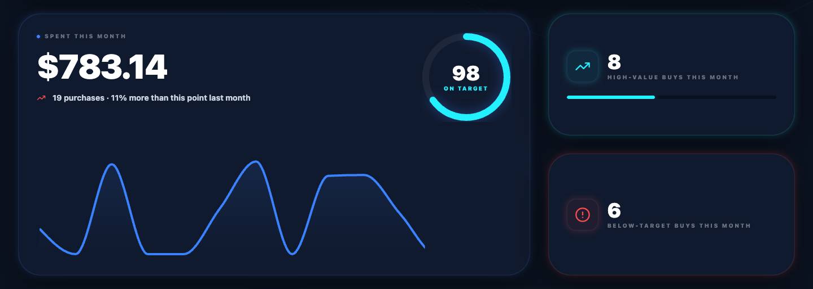
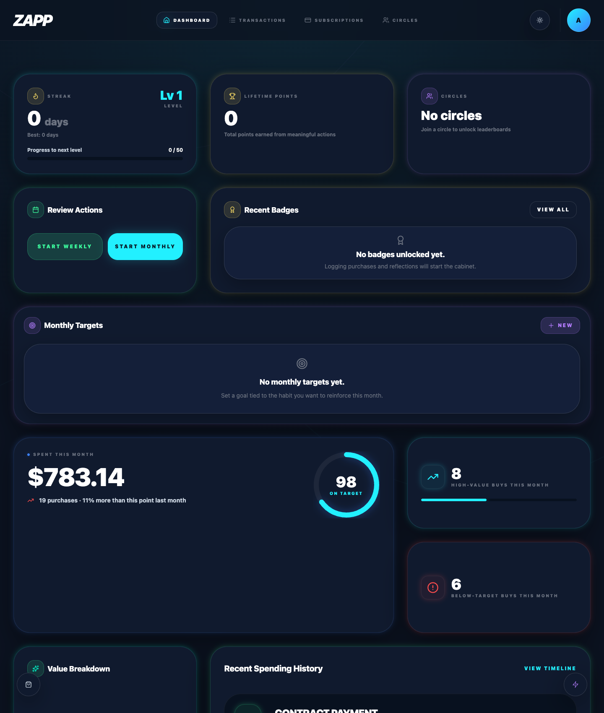
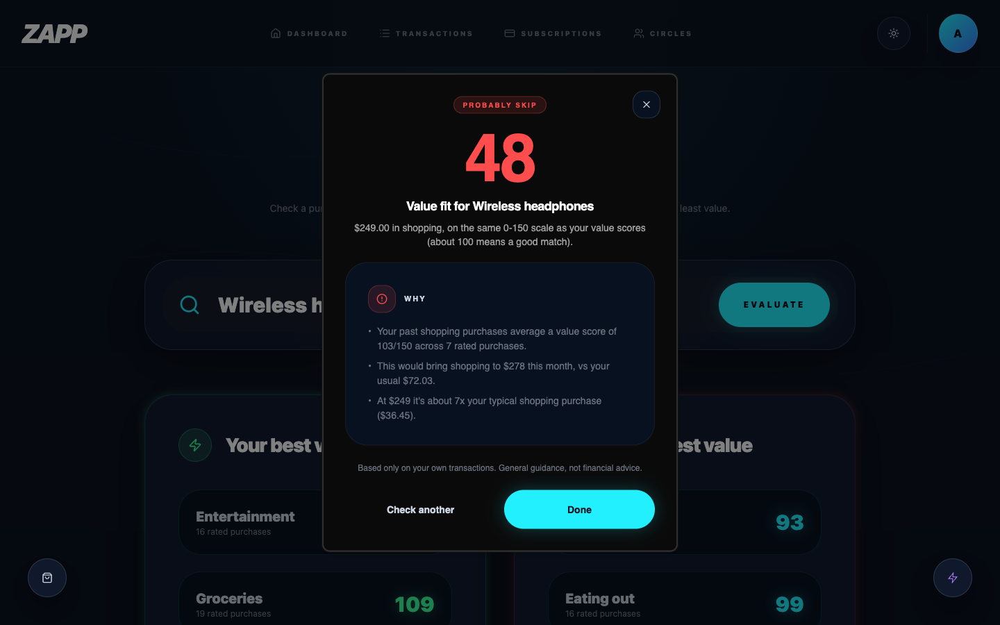
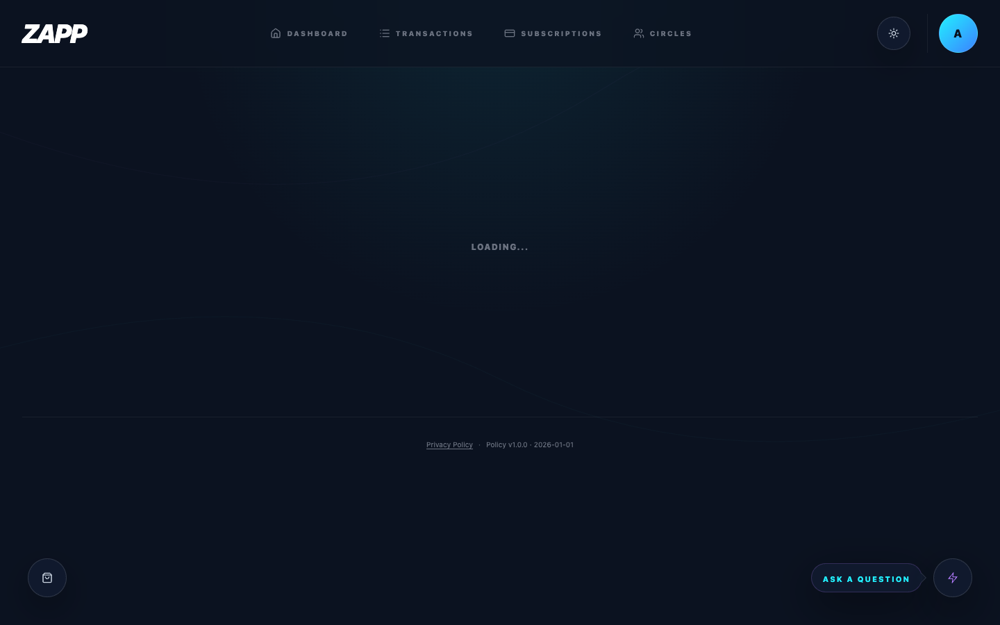
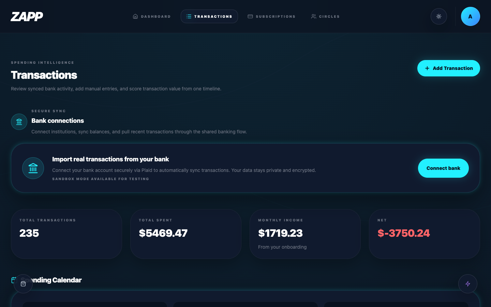
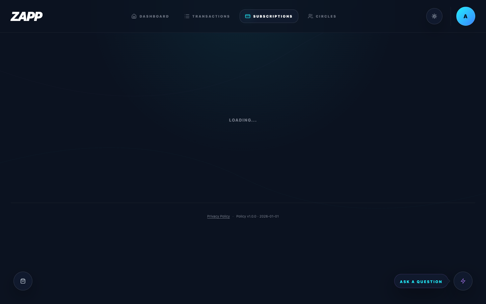
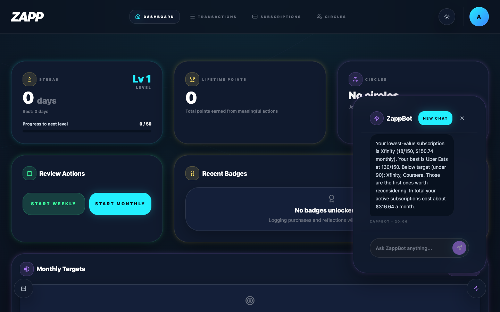
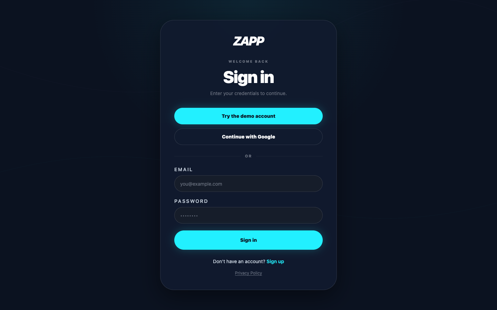
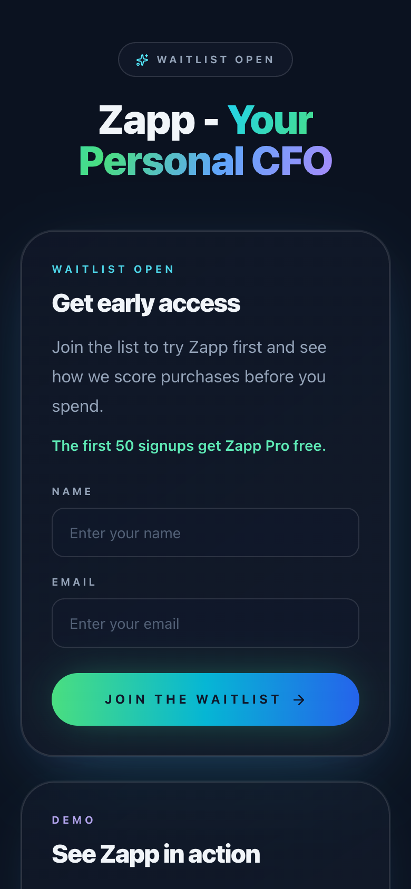
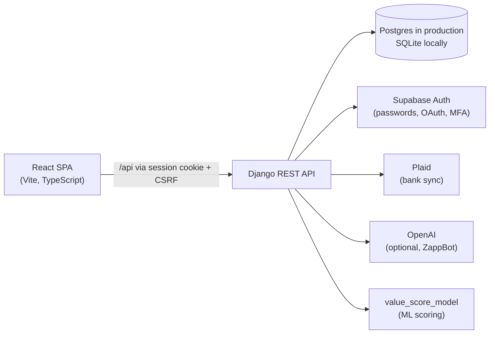

# Zapp: Your Personal CFO

[](https://github.com/adhvikrayaprolu/Zapp/actions/workflows/ci.yml)


People rarely waste money on purpose; they misjudge **value**. Zapp is a personal-finance
app that scores purchases against *your own* history, so you can decide whether something
is worth it **before** you buy, then learns from how you actually feel about what you bought.

**▶ [Watch the product demo](https://drive.google.com/file/d/1qQUz1jCqbmXztDwHBCopLaOQPJzMhOva/view?usp=sharing)**



## Highlights

- **One value scale, 0–150.** About 100 means a purchase fits you. It's computed from an ML
  model when available, otherwise from your own ratings of satisfaction, regret and
  whether you'd buy again.
- **Buy Advisor.** Explains, with real numbers, whether a purchase fits your history,
  monthly pace and typical price, then recommends *Looks worth it*, *Sleep on it* or
  *Probably skip*.
- **ZappBot.** A finance assistant grounded in your own data. It answers spending,
  subscription, savings and purchase questions locally, and can use an LLM for open-ended
  questions.
- **Secure by design.**
  - Supabase tokens stay on the server, and the browser only gets an HttpOnly session
    with CSRF protection.
  - Signing in requires MFA (AAL2).
  - Sensitive fields are encrypted at rest with Fernet keys that can be rotated.
- **Production-quality engineering.**
  - About 585 automated tests: 401 backend and 184 frontend.
  - An end-to-end smoke test that runs in CI on every PR.
  - One-command local setup with realistic synthetic data.

## Product tour

### Dashboard

Month-to-date spending compared with the same point last month, your average value score,
a 14-day spending chart, and how many purchases were high value or below target. Streaks,
points, badges, weekly and monthly reviews, and monthly targets build the habit.



### Buy Advisor

Enter an item, a price and a category. Zapp compares it with the last 180 days in that
category:

- how you rated similar purchases
- whether it would push you past your usual monthly spend
- how the price compares with what you typically pay
- how often you've bought in that category recently

Every factor that moves the score is shown, with the numbers behind it.



### Decision Engine

Start a purchase check from search, and see which categories have given you the most and
least value.



### Transactions and subscriptions

One timeline of manual and bank-synced transactions (via Plaid), with a spending calendar.
Each recurring subscription gets its own value score and recommendation.

| Transactions | Subscriptions |
| --- | --- |
|  |  |

### ZappBot

Ask about your spending, subscriptions, value scores or a possible purchase. Answers are
computed from your own transactions and scores. Example questions:

- "Which subscription gives me the least value?"
- "Where can I cut back?"
- "Should I buy headphones for $199?"



### Sign-in and early access

Email/password or Google sign-in with MFA, plus a one-click demo account for local use.
A mobile-friendly waitlist page collects early-access signups.

| Sign in | Waitlist (mobile) |
| --- | --- |
|  |  |

## Architecture



| Design decision | Why |
| --- | --- |
| **Backend-for-frontend auth:** Supabase tokens live in the Django session; the browser gets an HttpOnly cookie | No tokens in JavaScript; standard CSRF protection; MFA level enforced server-side |
| **Score source precedence:** model score → feedback score → rating estimate | Every purchase gets a comparable 0–150 score, even before the ML model has enough history |
| **Rule-based purchase check** instead of a black box | Recommendations are explainable, deterministic and testable |
| **ZappBot local insights layer** | Useful, grounded answers with no LLM dependency; an LLM is optional |
| **Field-level encryption** for amounts, descriptions, ratings, profile answers and Plaid tokens | Limits exposure if the database leaks; keys can be rotated |
| **Agent-based synthetic data generator** (`backend/datagen/`) | Realistic, reproducible demo and test data with no real financial data |

## Tech stack

| Layer | Technologies |
| --- | --- |
| Frontend | React 18, TypeScript, Vite, Tailwind CSS, Radix UI, Motion, Recharts, Vitest, Testing Library |
| Backend | Python 3.13, Django 6, Django REST Framework, Supabase Auth, Plaid, OpenAI, cryptography (Fernet) |
| Data | PostgreSQL (Supabase) in production, SQLite for local development and CI |
| Tooling | GitHub Actions CI with an end-to-end smoke test, Dependabot, headless-Chrome screenshot automation |

## Getting started

Requirements: **Python 3.13** and **Node 20+** on macOS or Linux. No accounts or API keys
are needed to run it locally.

```bash
git clone https://github.com/adhvikrayaprolu/Zapp.git
cd Zapp
./scripts/setup-local.sh   # virtualenv, dependencies, local config, database, demo account
./scripts/dev.sh           # API and web app together; Ctrl+C stops both
```

Then open **http://localhost:5173/login** and choose **Try the demo account**. You'll be
signed in with about six months of realistic synthetic activity.

`setup-local.sh` is idempotent: rerunning it keeps your existing config and resets the demo
data. If `python3.13` isn't on your `PATH`, run it as:

```bash
PYTHON=/path/to/python3.13 ./scripts/setup-local.sh
```

<details>
<summary><strong>Manual setup</strong></summary>

**Backend**

```bash
cd backend
python3.13 -m venv .venv && source .venv/bin/activate
pip install -r requirements.txt
cp .env.example .env            # set SECRET_KEY; SQLite is used if DATABASE_URL is unset
python manage.py migrate
python manage.py seed_demo
python manage.py runserver 127.0.0.1:8000
```

**Frontend**

```bash
cd frontend
npm ci
npm run dev                     # http://localhost:5173; /api is proxied to Django
```

</details>

### Optional integrations

Each integration is turned on by adding its credentials to `backend/.env`. The annotated
reference is [`backend/.env.example`](backend/.env.example).

| Integration | Settings |
| --- | --- |
| Real sign-up and sign-in (Supabase) | `SUPABASE_URL`, `SUPABASE_ANON_KEY`, `SUPABASE_JWT_*`, plus `VITE_SUPABASE_URL` and `VITE_SUPABASE_ANON_KEY` in the frontend |
| Open-ended ZappBot answers (OpenAI) | `OPENAI_API_KEY`, `OPENAI_MODEL` |
| Bank sync (Plaid sandbox) | `PLAID_CLIENT_ID`, `PLAID_SECRET`, `PLAID_ENV=sandbox` |
| Spotify subscription insights | `SPOTIFY_CLIENT_ID`, `SPOTIFY_CLIENT_SECRET` |
| ML value-score model | `VALUE_SCORE_BUNDLE_PATH`, `VALUE_SCORE_CHECKPOINT_DIR` |

## Testing and CI

```bash
cd backend && .venv/bin/python manage.py test   # 401 tests
cd frontend && npm run test:run                  # 184 tests
./scripts/smoke-test.sh                          # end-to-end checks against ./scripts/dev.sh
```

The [CI workflow](.github/workflows/ci.yml) runs on every pull request and on `main`. It has
three jobs:

1. **Backend:** Django system checks, migration drift check, and the test suite.
2. **Frontend:** the test suite and a production build. On `main`, the build is uploaded as an
   artifact.
3. **End-to-end smoke:** runs the quick start above on a clean runner, starts both servers,
   and checks health, demo sign-in, data loading, the purchase check, ZappBot and the
   waitlist, on both `127.0.0.1` and `localhost`.

Deployment ([`backend-cd.yml`](.github/workflows/backend-cd.yml)) is started manually: it
validates the production settings and then calls the hosting provider's deploy webhook.

## Project structure

```text
Zapp/
├── frontend/              React + TypeScript SPA
│   ├── src/features/      dashboard, transactions, subscriptions, Buy Advisor, ZappBot,
│   │                      onboarding, gamification, auth, …
│   ├── src/api/           typed API clients (cookies + CSRF handled centrally)
│   └── src/shared/        design system, value-score helpers, theme
├── backend/               Django REST API
│   ├── apps/              users (auth, MFA, onboarding) · transactions · subscriptions ·
│   │                      valuations (scores, purchase check) · ai (ZappBot) · banking ·
│   │                      gamification · integrations · compliance · waitlist
│   ├── config/            settings per environment, production security validation
│   ├── core/              field-level encryption
│   └── datagen/           agent-based synthetic data generator
├── scripts/               setup-local.sh · dev.sh · smoke-test.sh · capture-screenshots.mjs
└── .github/               CI, deploy workflow, Dependabot, issue and PR templates
```

## API at a glance

| Area | Endpoints |
| --- | --- |
| Auth | `/api/auth/session/`, `/login/`, `/signup/`, `/logout/`, `/me/`, `/mfa/*`, `/oauth/*` |
| Spending | `/api/transactions/`, `/api/subscriptions/`, `/api/merchants/` |
| Value | `/api/subscription-valuations/`, `/api/transaction-valuations/`, `POST /api/purchase-check/` |
| ZappBot | `/api/ai/conversations/`, `…/messages/`, `…/messages/stream/` (Server-Sent Events) |
| Banking | `/api/banking/*` (Plaid link, accounts, sync, feedback) |
| Engagement | `/api/gamification/*` (streaks, badges, circles, reviews, targets) |
| Public | `GET /healthz/`, `POST /api/waitlist-signups/` |

More detail lives in [`frontend/README.md`](frontend/README.md) and
[`backend/README.md`](backend/README.md).
